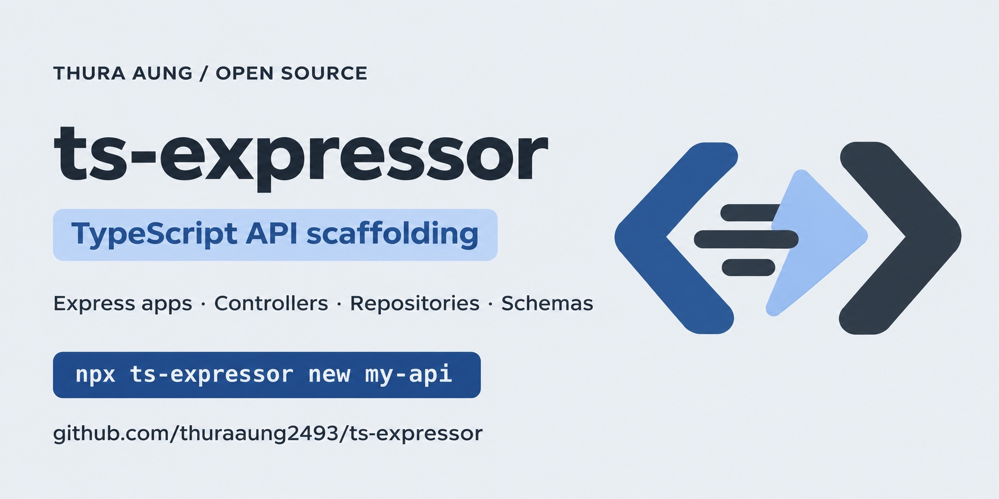

<p align="center">
  
</p>

# ts-expressor

A CLI tool for generating TypeScript-based Express applications focuses on API development. Additionally include file generating commands for `Controller` class, `Validation Schema`, and `Repository` class.



An open-source project by [Thura Aung](https://thuraaung2493.github.io/).

## Installation

```bash
# Global Install
npm install -g ts-expressor

# Or
npx ts-expressor
```

## How to use

### Create New App

```bash
npx ts-expressor new my-express-app
```

### Create Controller Class

```bash
  npx ts-expressor make:controller user
```

`UserController` class created in `./src/app/controllers/user.controller.ts`

### Create Repository Class

```bash
  npx ts-expressor make:repository user
```

`UserRepository` class created in `./src/app/controllers/user.repository.ts`

### Create Validation Schema

```bash
  npx ts-expressor make:schema user
```

The file user.schema.ts has been created in the `./src/app/validateSchema` directory.
